# PulseIQ star schema

## Join map

| Fact | Dimensions / related table | Join key or rule |
|---|---|---|
| `fact_payroll` | `dim_employee`, `dim_date`, `dim_department`, `dim_role` | `employee_key`, `date_key`, `department_id`, `role_id` |
| `fact_attendance_monthly` | `dim_employee`, `dim_date`, `dim_department` | `employee_key`, `date_key`, `department_id` |
| `fact_leave` | `dim_employee`, `dim_leave_type`, `dim_date` | `employee_key`, `leave_type_code`, `start_date_key` and `end_date_key` |
| `fact_headcount_monthly` | `dim_department`, `dim_date` | `department_id`, `date_key` |
| `fact_ledger` | `dim_account`, `dim_department`, `dim_date` | `account_code`, `cost_center_department_id`, `date_key` |
| `fact_invoice` | `dim_client`, `dim_account`, `dim_date` | `client_id`, `service_line_account`, `invoice_date_key` |
| `fact_invoice_payment` | `fact_invoice`, `dim_date` | `invoice_id`, `payment_date_key` |
| `fact_expense` | `dim_vendor`, `dim_account`, `dim_department`, `dim_date` | `vendor_id`, `category_account`, `department_id`, `expense_date_key` |
| `fact_task` | `dim_team`, `dim_sprint`, `dim_employee` | `team_id`, `sprint_id`; employee version is looked up by assignee and task date |
| `fact_anomaly` | `dim_employee`, `dim_date` | Employee version is looked up by `employee_id` at the period's month end; date uses `period_key` |
| `fact_attrition_risk` | `dim_employee`, `dim_department`, `dim_date` | `employee_key`, `department_id`, `as_of_date_key` |
| `fact_forecast` | `dim_department`, `dim_date` | `department_id` (except `ALL` scope), `forecast_month_key` |

## ER diagram

```mermaid
erDiagram
    dim_employee ||--o{ fact_payroll : employee_key
    dim_location ||--o{ dim_employee : work_location
    dim_date ||--o{ fact_payroll : date_key
    dim_department ||--o{ fact_payroll : department_id
    dim_role ||--o{ fact_payroll : role_id

    dim_employee ||--o{ fact_attendance_monthly : employee_key
    dim_date ||--o{ fact_attendance_monthly : date_key
    dim_department ||--o{ fact_attendance_monthly : department_id

    dim_employee ||--o{ fact_leave : employee_key
    dim_leave_type ||--o{ fact_leave : leave_type_code
    dim_date ||--o{ fact_leave : start_and_end_date_keys

    dim_department ||--o{ fact_headcount_monthly : department_id
    dim_date ||--o{ fact_headcount_monthly : date_key

    dim_account ||--o{ fact_ledger : account_code
    dim_department ||--o{ fact_ledger : cost_center_department_id
    dim_date ||--o{ fact_ledger : date_key

    dim_client ||--o{ fact_invoice : client_id
    dim_account ||--o{ fact_invoice : service_line_account
    dim_date ||--o{ fact_invoice : invoice_date_key

    fact_invoice ||--o{ fact_invoice_payment : invoice_id
    dim_date ||--o{ fact_invoice_payment : payment_date_key

    dim_vendor ||--o{ fact_expense : vendor_id
    dim_account ||--o{ fact_expense : category_account
    dim_department ||--o{ fact_expense : department_id
    dim_date ||--o{ fact_expense : expense_date_key

    dim_team ||--o{ fact_task : team_id
    dim_sprint ||--o{ fact_task : sprint_id
    dim_employee ||--o{ fact_task : employee_version_at_task_date

    dim_employee ||--o{ fact_anomaly : employee_version_at_period
    dim_date ||--o{ fact_anomaly : period_key

    dim_employee ||--o{ fact_attrition_risk : employee_key
    dim_department ||--o{ fact_attrition_risk : department_id
    dim_date ||--o{ fact_attrition_risk : as_of_date_key

    dim_department ||--o{ fact_forecast : department_scope
    dim_date ||--o{ fact_forecast : forecast_month_key
```



## Employee history rule

`dim_employee` is a Type 2 slowly changing dimension: one employee can have several rows, each with its own `employee_key`, `valid_from`, and `valid_to`. A fact uses the employee version whose validity period contains the fact date. For example, June payroll joins to the employee version valid in June; if the employee transfers to Support in July, July payroll joins to the new version. The employee's old months stay attributed to the old department. For monthly anomaly periods, the month-end date is used as the as-of date so the chosen employee version represents the period end.

## Contract and reconciliation scope

Task 1 supplied detailed contracts for `fact_anomaly`, `fact_attrition_risk`, `fact_forecast`, and `fact_task`. For every fact column, the pipeline also applies the type and nullability documented in `data_dictionary.csv`. The other eight facts have no supplied allowed-value/business-rule contracts; their validation status is `DICTIONARY_SCHEMA_VALIDATED`, not full detailed-contract validation. The warehouse reconciliation has 12/12 matching counts, with validation scope shown per fact.

## Build and audit

From the project root, run Task 1 first, then build the warehouse:

```powershell
python .\task_1\etl.py
python .\task_2\build_warehouse.py
```

The warehouse build creates 11 dimensions and 12 facts in the `warehouse` schema. Every table has a primary key. All 12 fact row counts match Task 1's passed counts. The four detailed-contract feeds are anomaly 405, attrition risk 430, forecast 72, and task 28,848; the other eight were checked against dictionary type/nullability and have no supplied allowed-value rules.

The latest orphan audit records 261 relationship exceptions in `audit.orphan_rows`:

| Relationship | Rows | Explanation |
|---|---:|---|
| `fact_task` assignee at task date | 202 | The employee IDs exist, but no employee SCD version covers the task date. |
| `fact_anomaly` employee at period end | 21 | The employee IDs exist, but no SCD version covers that period end. |
| `fact_forecast` month to date dimension | 36 | The referenced forecast months are January through March 2027; the supplied calendar ends in December 2026. |
| `fact_payroll` employee key | 2 | The source uses `employee_key = -1` for employee IDs `EMP-9001` and `EMP-9002`, which have no dimension rows. |

These are recorded and explained, not silently dropped. A NULL `cost_center_department_id` in `fact_ledger` is treated as an unallocated cost center, not as an orphan. Forecast department scope `ALL` is also an intentional exception.

The current row-by-row count reconciliation and status labels are saved in `evidence/reconciliation.md`.
